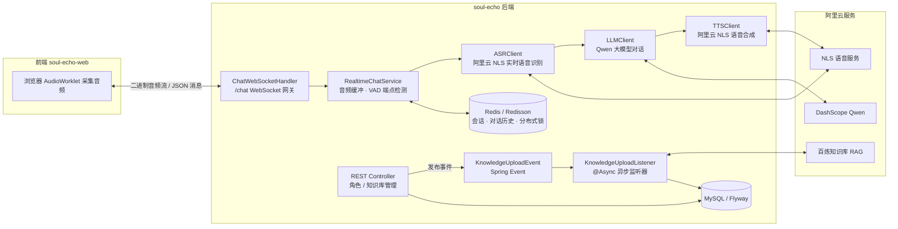
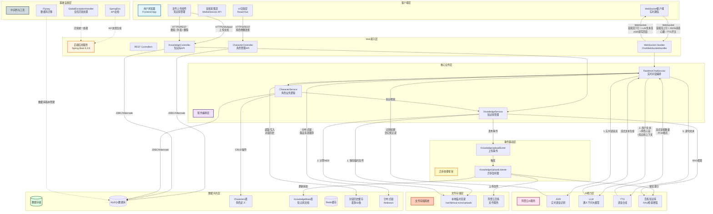
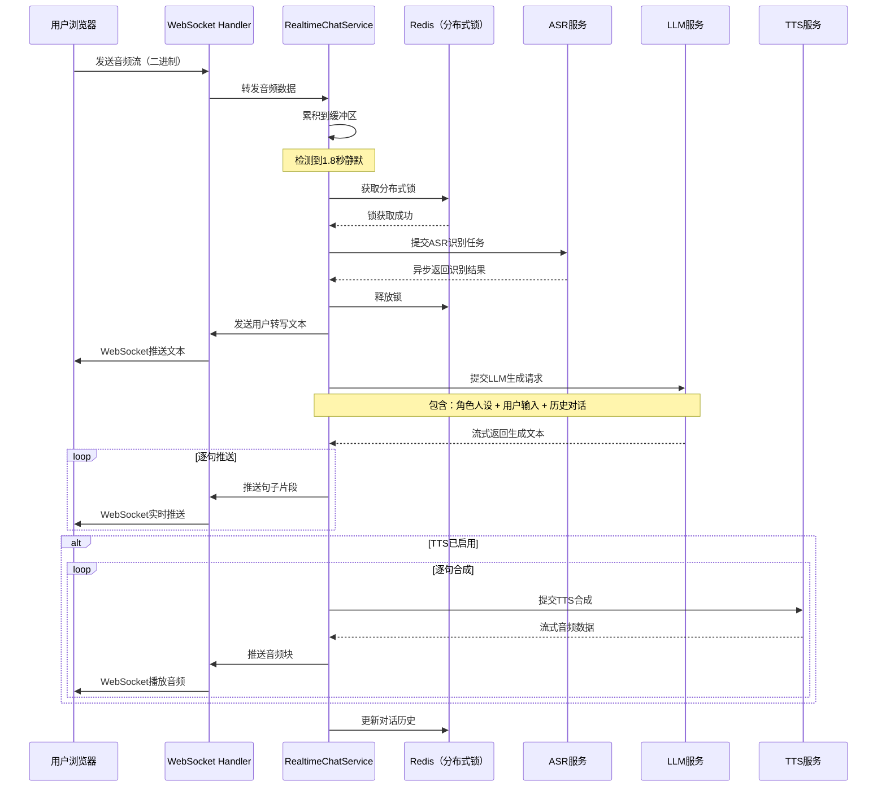
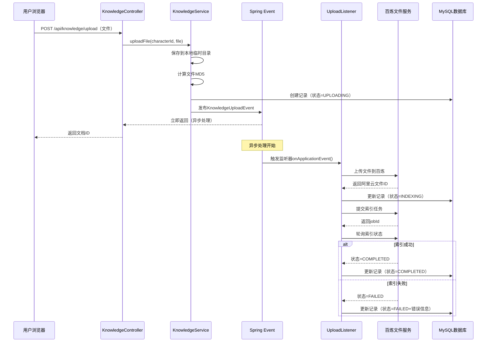

# 魂语计划 (SoulEchoPlan) · 后端

> **项目托管与来源说明**
> - **所属项目**：本项目为「魂语计划 (SoulEchoPlan)」核心后端服务，原项目归档于团队组织：[@SoulEchoPlan/soul-echo](https://github.com/SoulEchoPlan/soul-echo)。
> - **个人角色**：独立架构设计与后端研发
> - **版本与提交**：本仓库为个人同步镜像，完整保留了全部原始 Git Commit 历史与演进链路。规范的团队协作流程（CR、PR）可追溯至组织仓库。

---

## 项目简介 (Overview)

**魂语计划**是一个基于**事件驱动架构 (Event-Driven Architecture)** 的 AI 角色即时通讯系统，来源于 [七牛云 AI 共创挑战赛](https://www.qiniu.com/activity/detail/68ac208628614a718ed2319c?channel=boss#topic)。

用户可以创建拥有独立人设 (Persona Prompt) 的 AI 角色，并通过 **文本 / 实时语音** 与其对话；还能为角色挂载专属 **知识库 (RAG)**，让角色基于私有资料进行回答——例如与"专属版福尔摩斯"探讨案件。

它解决的核心痛点：

- **语音交互割裂**：传统方案需要"录音 → 上传 → 识别 → 回复 → 播放"多次往返，本服务在**单条 WebSocket 长连接**内完成音频流上行、实时识别 (ASR)、大模型推理 (LLM) 与语音合成 (TTS) 下行的全双工链路。
- **角色缺乏"记忆与知识"**：通过阿里云百炼 (Bailian) 实现 RAG 检索增强，让每个角色拥有可增量维护的私有知识库。
- **AI 任务阻塞请求线程**：知识库上传、索引构建等耗时操作通过 **Spring Event + 独立线程池异步化**，主链路零阻塞。

## 核心特性

| 特性 | 说明 |
| --- | --- |
| 🎙️ 实时语音对话 | WebSocket 二进制流 + 语音端点检测 (VAD，1.8s 静默判定)，全双工低延迟交互 |
| 💬 文本对话 | 基于 Qwen (通义千问) 大模型，支持多轮上下文（默认保留最近 50 条） |
| 📚 RAG 知识库 | 文档上传 → 云端索引构建 → 检索增强问答，状态机管理（`UPLOADING → INDEXING → COMPLETED / FAILED`） |
| 🧩 角色管理 | 角色 CRUD，人设提示词、语音音色、头像、知识库绑定全可配置 |
| ⚡ 事件驱动 | Spring Event + `@Async` 独立线程池，耗时 AI 任务与请求线程解耦 |
| 🔒 分布式协调 | Redisson 分布式锁 + Redis 会话/对话历史管理 |
| 🗄️ 版本化 Schema | Flyway 管理 MySQL 数据库迁移，`validate` 模式保证实体与表结构一致 |
| 📖 OpenAPI 文档 | springdoc-openapi 内置 Swagger UI |

## 技术栈 (Tech Stack)

| 分类 | 技术 |
| --- | --- |
| 语言 / 框架 | Java 17 · Spring Boot 3.2.8 |
| 通信 | Spring WebSocket（文本 + 二进制流）· RESTful API |
| 数据持久化 | MySQL 8 · Spring Data JPA · Flyway |
| 缓存 / 并发 | Redis 7 · Redisson 3.x（RLock / RList） |
| AI 能力（阿里云） | DashScope SDK（Qwen LLM）· NLS SDK（ASR / TTS）· 百炼 Bailian SDK（RAG 知识库） |
| 文档 / 工具 | springdoc-openapi · Lombok · JUnit 5 · Docker Compose |

## 系统架构 (Architecture)



**实时语音链路**（单 WebSocket 连接内闭环）：

1. 前端通过 `AudioWorklet` 采集并重采样音频，以二进制帧推送至 `/chat`；
2. 服务端按会话缓冲音频流，基于 1.8s 静默超时进行端点检测 (VAD)；
3. 语音段交由 ASR 转写 → 拼接对话历史调用 LLM → 响应文本经 TTS 合成；
4. 合成音频与文本消息通过 WebSocket 下行回传前端播放。

**知识库链路（事件驱动）**：`KnowledgeController` 接收上传 → 落库并发布 `KnowledgeUploadEvent` → `KnowledgeUploadListener` 在独立线程池 (`knowledgeUploadExecutor`) 中异步完成"上传百炼 → 提交索引任务 → 回写状态"，全程不阻塞请求线程，前端可通过状态接口轮询进度。

<details>
<summary><strong>🔭 完整架构图（分层视图）</strong></summary>



</details>

<details>
<summary><strong>🎙️ 实时语音对话时序</strong></summary>



</details>

<details>
<summary><strong>📚 知识库上传时序（事件驱动）</strong></summary>



</details>

## 项目结构 (Project Layout)

```
src/main/java/com/dotlinea/soulecho
├── client/        # 外部 AI 服务客户端（ASR / LLM / TTS 及其实现）
├── config/        # 配置类（WebSocket / CORS / Async 线程池 / 百炼）
├── constants/     # 常量（消息类型 / Redis Key / 人设提示词等）
├── controller/    # REST 控制器（角色、知识库）+ WebSocket 处理器
├── dto/           # 请求 / 响应 / WebSocket 消息 DTO
├── entity/        # JPA 实体（Character、KnowledgeBase）
├── event/         # 领域事件（KnowledgeUploadEvent）
├── exception/     # 统一异常体系（ErrorCode / GlobalExceptionHandler）
├── factory/       # WebSocket 消息工厂（统一消息协议）
├── listener/      # 事件监听器（异步知识库索引）
├── repository/    # Spring Data JPA 数据访问层
├── service/       # 业务逻辑（含实时语音核心 RealtimeChatService）
└── util/          # 工具类
src/main/resources
├── application.properties        # 配置（支持环境变量占位符）
└── db/migration/V1__Init_Schema.sql  # Flyway 初始 Schema
```

## 快速开始 (Quick Start)

### 1. 前置要求

- JDK 17+、Maven 3.8+
- Docker & Docker Compose
- 阿里云账号：DashScope API Key、NLS 语音服务、百炼工作空间（Demo 跑通至少需要 LLM 的 API Key）

### 2. 启动基础设施

复制仓库根目录的 `.env.example` 生成本地 `.env` 文件，并填入真实值：

```bash
# Linux / macOS
cp .env.example .env

# Windows (PowerShell)
copy .env.example .env
```

`docker-compose.yml` 会从 `.env` 中读取以下变量来初始化 MySQL 与 Redis：

```dotenv
DB_PORT=3306
DB_ROOT_PASSWORD=your_root_password
DB_DATABASE=soul_echo_db
DB_USER=soul_echo
DB_PASSWORD=your_db_password
REDIS_PASSWORD=your_redis_password
```

一键拉起 MySQL 8 与 Redis 7：

```bash
docker-compose up -d
```

### 3. 配置应用

数据库 Schema 由 Flyway 在启动时自动迁移，无需手动建表。将 AI 服务密钥等敏感配置写入环境变量（可参考 `src/main/resources/application.properties` 中的占位符），例如：

```dotenv
LLM_API_KEY=sk-xxxx          # DashScope API Key（LLM）
ASR_API_KEY / ASR_API_SECRET / ASR_APP_KEY   # 阿里云 NLS 语音识别
TTS_API_KEY / TTS_API_SECRET / TTS_APP_KEY   # 阿里云 NLS 语音合成
BAILIAN_WORKSPACE_ID / BAILIAN_API_KEY       # 百炼知识库
JWT_SECRET / ENCRYPTION_KEY                  # 安全密钥（生产环境务必修改）
FILE_UPLOAD_PATH=./uploads                   # Windows 本地调试建议改用相对路径
```

> [!IMPORTANT]
> 本项目针对阿里云服务接口深度优化。若需切换至其他服务商（如 OpenAI、Azure），需对底层 Adapter（`client` 包）做适配性重构，建议优先使用默认配置跑通 Demo。

### 4. 构建与运行

```bash
# 开发模式运行
mvn spring-boot:run

# 或打包运行
mvn clean package -DskipTests
java -jar target/soul-echo-0.0.1-SNAPSHOT.jar
```

服务启动后：

- 服务地址：`http://localhost:8080`
- Swagger UI：`http://localhost:8080/swagger-ui.html`
- WebSocket 端点：`ws://localhost:8080/chat`

## API 概览 (API Reference)

### REST 接口

| 方法 | 路径 | 说明 |
| --- | --- | --- |
| `GET` | `/api/characters` | 获取角色列表 |
| `GET` | `/api/characters/{id}` | 获取角色详情 |
| `POST` | `/api/characters` | 创建角色 |
| `PUT` | `/api/characters/{id}` | 更新角色 |
| `DELETE` | `/api/characters/{id}` | 删除角色 |
| `POST` | `/api/characters/chat` | 文本对话 |
| `POST` | `/api/knowledge/upload` | 上传知识库文档（异步索引） |
| `GET` | `/api/knowledge/search` | 知识库检索（RAG） |
| `GET` | `/api/knowledge?characterId=` | 查询角色的文档列表与索引状态 |
| `DELETE` | `/api/knowledge/{id}` | 删除知识库文档 |

### WebSocket 协议

- **端点**：`/chat`（握手示例：`ws://localhost:8080/chat?characterId={id}&personaPrompt={prompt}`）
- **上行**：二进制帧（音频 `ArrayBuffer` 流）+ 文本帧（JSON 控制消息）
- **下行**：JSON 消息（ASR 转写结果 / LLM 回复 / TTS 音频 / 错误通知），由 `WebSocketMessageFactory` 统一封装
- **心跳**：标准 `ping`/`pong` 机制维持长连接

完整交互规范与前端联调说明见 [运行环境与配置说明](https://github.com/SoulEchoPlan/docs/blob/main/Operating_Environment&Configuration_Instructions.md)。

## 测试 (Testing)

```bash
# 运行全部单元测试
mvn test
```

测试覆盖 WebSocket 消息协议（`WebSocketMessageDTOTest`）、消息工厂（`WebSocketMessageFactoryTest`）与消息安全性（`WebSocketMessageSecurityTest`）等核心模块。

## 相关仓库 (Related Repositories)

1. **后端项目**（本仓库镜像源）：[SoulEchoPlan/soul-echo](https://github.com/SoulEchoPlan/soul-echo)
2. **前端项目**：[SoulEchoPlan/soul-echo-web](https://github.com/SoulEchoPlan/soul-echo-web)
3. **开发文档**：[SoulEchoPlan/docs](https://github.com/SoulEchoPlan/docs)

## License

本项目基于 [MIT License](LICENSE) 开源。
